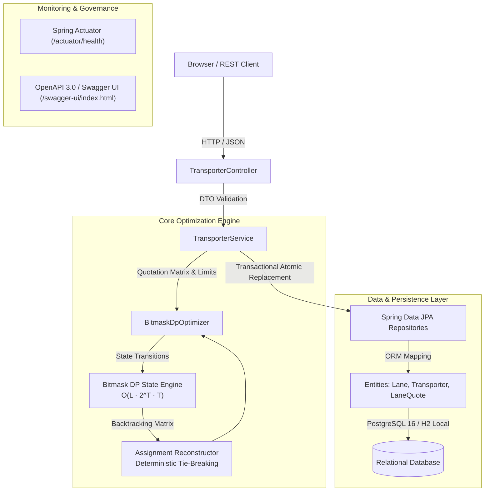

# FreightFox — Transporter Lane Assignment Optimizer

[](https://spring.io/projects/spring-boot)
[](https://www.oracle.com/java/)
[](https://www.postgresql.org/)
[](https://www.docker.com/)
[-success.svg)](https://junit.org/junit5/)
[](#testing--verification)
[](http://localhost:8081/swagger-ui/index.html)

A high-performance, deterministic logistics optimization microservice built for **FreightFox**. The service solves the multi-lane transporter procurement problem using **Bitmask Dynamic Programming (DP)**, optimizing lane allocations against a **strict lexicographic objective**: maximizing transporter diversity across network lanes up to a business quota, followed by minimizing total freight expenditure, backed by deterministic tie-breaking.

Includes an interactive single-page web dashboard with an automated **CSV Upload and Analytics Tool** supporting both flat and matrix freight rate grids.

---

## Table of Contents

1. [System Architecture](#system-architecture)
2. [Optimization Problem & Lexicographic Objective](#optimization-problem--lexicographic-objective)
3. [Algorithm & Complexity Analysis](#algorithm--complexity-analysis)
4. [Database Design & Transactional Integrity](#database-design--transactional-integrity)
5. [Interactive Web Frontend & CSV Analyzer](#interactive-web-frontend--csv-analyzer)
6. [API Reference & OpenAPI Documentation](#api-reference--openapi-documentation)
7. [Testing & Quality Assurance](#testing--quality-assurance)
8. [Getting Started (Local Execution)](#getting-started-local-execution)
9. [Running with Docker & Docker Compose](#running-with-docker--docker-compose)
10. [Cloud Deployment Guide](#cloud-deployment-guide)

---

## System Architecture

The application follows clean architecture principles with strict separation of concerns across presentation, business logic, persistence, and algorithmic optimization.



### Key Components

- **`TransporterController`**: Exposes REST endpoints for dataset ingestion (`/api/v1/transporters/input`) and assignment optimization (`/api/v1/transporters/assignment`).
- **`BitmaskDpOptimizer`**: The pure computational core solving the exact optimal assignment problem via rolling-array bitmask dynamic programming.
- **`TransporterService`**: Coordinates data validation, atomic transactional replacement, quotation matrix assembly, and DTO transformation.
- **`GlobalExceptionHandler`**: Translates validation constraints, missing resources, and optimization infeasibilities into structured RFC 7807 error envelopes.
- **Frontend SPA**: Self-contained single-page application (`index.html`) featuring a live CSV matrix parser, interactive drag-and-drop ingestion, and real-time interactive solver.

---

## Optimization Problem & Lexicographic Objective

In enterprise freight procurement, relying on a single transporter poses significant supply chain vulnerability. Conversely, unconstrained spreading of lanes increases overhead. FreightFox addresses this through a **strict lexicographic objective function**:

$$\max \left( |\mathcal{T}_{\text{used}}| \le K_{\text{max}} \right) \quad \longrightarrow \quad \min \sum_{l=1}^{L} \text{Quote}(l, \text{assignment}(l)) \quad \longrightarrow \quad \text{Deterministic Tie-Breaking}$$

### Priority 1: Transporter Diversity Maximization
Among all feasible allocations where each of the $L$ lanes is assigned to exactly one quoting transporter, find solutions that utilize the **maximum possible number of distinct transporters**, bounded by `maxTransporters` ($K_{\text{max}}$):

$$K^* = \max \left\{ |\mathcal{T}_{\text{assigned}}| \;\middle|\; |\mathcal{T}_{\text{assigned}}| \le K_{\text{max}} \right\}$$

> **Important**: Even if a solution using fewer transporters achieves lower monetary cost, the solution utilizing more distinct transporters (up to $K_{\text{max}}$) is strictly preferred.

### Priority 2: Total Freight Cost Minimization
Among all assignments that achieve the maximal transporter count $K^*$, select the assignment that yields the minimal cumulative procurement cost:

$$\text{Cost}^* = \min \sum_{l=1}^{L} \text{Quote}(l, \tau_l) \quad \text{subject to } |\bigcup_{l=1}^L \{\tau_l\}| = K^*$$

### Priority 3: Deterministic Tie-Breaking
If multiple assignments achieve identical maximal transporter count and identical minimal cost:
1. **Transporter Set Comparison**: Compare the sorted transporter ID lists lexicographically. The set whose first differing transporter ID is smaller alphabetically wins.
2. **Lane Assignment Comparison**: If the selected transporter sets are identical, iterate through lanes from index $0$ to $L-1$. The assignment assigning a lexicographically smaller transporter ID on the first differing lane wins.

---

## Algorithm & Complexity Analysis

### Dynamic Programming State Formulation

Let $L$ be the number of lanes ($0 \le l < L$) and $T$ be the number of distinct transporters ($0 \le t < T$). Transporters are sorted lexicographically by ID and mapped to bit indices $0, 1, \dots, T-1$.

A state is defined by:
- $l$: The lane index currently being assigned ($0 \le l \le L$).
- $mask \in [0, 2^T - 1]$: A bitmask representing the subset of transporters assigned at least one lane among the first $l$ lanes.
- $dp[mask]$: The minimal monetary cost to assign the first $l$ lanes such that exactly the transporters in $mask$ are utilized.

### State Transition

For lane $l$ (1-indexed) and each valid quote from transporter $t$ at cost $c$:

$$dp_{\text{curr}}[mask \mid (1 \ll t)] = \min\left( dp_{\text{curr}}[mask \mid (1 \ll t)], \; dp_{\text{prev}}[mask] + c \right)$$

### Memory Optimization: Rolling Cost Arrays & Backtracking

- **Rolling DP Tables**: Rather than storing a full 3D array of size $L \times 2^T \times \text{BigDecimal}$, the algorithm alternates between two rolling arrays: `prevCost[1 << T]` and `currCost[1 << T]`.
- **Parent Tracking Matrix**: To reconstruct the exact lane assignments without storing stale values, a compact 2D array `parent[L][1 << T]` records the previous mask `prevMask` and chosen transporter $t$:
  $$\text{parent}[l][mask] = (\text{prevMask} \ll 8) \mid t$$
  This uses only **4 bytes per state entry** instead of heap-allocated objects.
- **Scale-Safe Monetary Comparison**: Cost updates use `BigDecimal.compareTo(...) == 0` rather than `.equals()`, preventing scale-related rounding anomalies.

### Complexity & Limits

| Metric | Complexity | Empirical Value ($T \le 7, L \le 9$) | Upper Bound ($T \le 20$) |
|---|---|---|---|
| **Time Complexity** | $\mathcal{O}(L \cdot 2^T \cdot T)$ | $< 2$ milliseconds | $< 450$ milliseconds |
| **Space Complexity** | $\mathcal{O}(L \cdot 2^T)$ | $< 1$ MB RAM | $\approx 80$ MB RAM |
| **Input Constraint** | Validates $T \le 20$ | Validated | Hard rejection with HTTP 400 |

Input payloads exceeding $T > 20$ transporters are rejected before execution with a descriptive HTTP 400 error, guaranteeing that heap memory cannot be exhausted.

---

## Database Design & Transactional Integrity

### Entity Relationship Model

```
+------------------------+           +-----------------------------+
|         LANE           |           |         TRANSPORTER         |
+------------------------+           +-----------------------------+
| PK  lane_id   VARCHAR  |           | PK  transporter_id  VARCHAR |
|     origin    VARCHAR  |           |     name            VARCHAR |
|     dest      VARCHAR  |           +-----------------------------+
+------------------------+                          |
            | 1                                     | 1
            |                                       |
            | N                                     | N
+------------------------------------------------------------------+
|                            LANE_QUOTE                            |
+------------------------------------------------------------------+
| PK  id               BIGSERIAL                                   |
| FK  lane_id          VARCHAR (REFERENCES lane)                   |
| FK  transporter_id   VARCHAR (REFERENCES transporter)            |
|     quote_amount     NUMERIC(15, 2)                              |
+------------------------------------------------------------------+
```

### Transactional Atomic Replacement Semantics

The endpoint `POST /api/v1/transporters/input` provides **strict transactional replacement**:
1. **Full Pre-Validation**: The entire input JSON payload is validated prior to executing any database mutation (checking for duplicate lane IDs, duplicate transporter IDs, duplicate quotations for the same pair, unreferenced lanes, zero/negative quotes, blank strings).
2. **Atomic Deletion & Insertion**: Deletion of existing quotes, lanes, and transporters and insertion of new records occurs within a single `@Transactional` boundary.
3. **Rollback Guarantee**: If any persistence error, foreign-key violation, or database failure occurs mid-transaction, Spring's transaction manager rolls back all modifications, restoring the database to its exact prior state. This is verified by `DatabaseRollbackIntegrationTest`.

---

## Interactive Web Frontend & CSV Analyzer

The application serves a modern, responsive single-page dashboard at `http://localhost:8081/`:

- **Dual CSV Parsing Engine**:
  - **Matrix Grid Format**: Parses datasets formatted as row/column cross-tabs (e.g. `Trade Lane, T1, T2, T3...`), exactly matching standard enterprise freight tenders.
  - **Flat Format**: Parses row-by-row records (`Lane ID, Origin, Destination, Transporter ID/Name, Quote`).
- **Interactive Controls**:
  - Drag-and-drop or file browser upload for instant file reading.
  - Live preview of parsed lanes, routes, transporters, and quotations before submission.
  - Dynamic `maxTransporters` stepper selector.
  - One-click dataset ingestion (`/api/v1/transporters/input`) and assignment execution (`/api/v1/transporters/assignment`).
  - Metric summary cards displaying total freight expenditure, active transporters utilized, and lane coverage.
  - Color-coded transporter assignment result table.

---

## API Reference & OpenAPI Documentation

Interactive Swagger UI documentation is available at:
- **Swagger UI**: [http://localhost:8081/swagger-ui/index.html](http://localhost:8081/swagger-ui/index.html)
- **OpenAPI 3.0 JSON**: [http://localhost:8081/v3/api-docs](http://localhost:8081/v3/api-docs)

### 1. Ingest Dataset (Atomic Replacement)
`POST /api/v1/transporters/input`

#### Request Body
```json
{
  "lanes": [
    { "id": 1, "origin": "DELHI", "destination": "MUMBAI" },
    { "id": 2, "origin": "MUMBAI", "destination": "BANGALORE" }
  ],
  "transporters": [
    {
      "id": 1,
      "name": "Safe Transport",
      "laneQuotes": [
        { "laneId": 1, "quote": 15000.00 }
      ]
    },
    {
      "id": 2,
      "name": "Speedy Freight",
      "laneQuotes": [
        { "laneId": 1, "quote": 14200.00 },
        { "laneId": 2, "quote": 21000.00 }
      ]
    },
    {
      "id": 3,
      "name": "Apex Logistics",
      "laneQuotes": [
        { "laneId": 2, "quote": 19500.00 }
      ]
    }
  ]
}
```

#### Response (`200 OK`)
```json
{
  "status": "SUCCESS",
  "lanesCount": 2,
  "transportersCount": 3,
  "quotesCount": 4,
  "message": "Input data saved successfully. Previous data has been replaced."
}
```

---

### 2. Compute Optimal Assignment
`POST /api/v1/transporters/assignment`

#### Request Body
```json
{
  "maxTransporters": 2
}
```

#### Response (`200 OK`)
```json
{
  "status": "SUCCESS",
  "totalCost": 33700.00,
  "selectedTransporters": [
    {
      "transporterId": 2,
      "transporterName": "Speedy Freight"
    },
    {
      "transporterId": 3,
      "transporterName": "Apex Logistics"
    }
  ],
  "assignments": [
    {
      "laneId": 1,
      "origin": "DELHI",
      "destination": "MUMBAI",
      "transporterId": 2,
      "transporterName": "Speedy Freight",
      "assignedQuote": 14200.00
    },
    {
      "laneId": 2,
      "origin": "MUMBAI",
      "destination": "BANGALORE",
      "transporterId": 3,
      "transporterName": "Apex Logistics",
      "assignedQuote": 19500.00
    }
  ],
  "totalLanes": 2,
  "assignedLanes": 2,
  "transporterCount": 2
}
```

#### Error Codes & RFC 7807 Responses
- `400 Bad Request`: Validation failure (negative quotes, unknown lane IDs, invalid `maxTransporters`, empty payload).
- `404 Not Found`: No lane or quotation records exist in the database.
- `422 Unprocessable Entity`: No feasible assignment exists (e.g., an unquoted lane or disjoint coverage).

---

## Testing & Quality Assurance

The test suite comprises **39 comprehensive unit, property, and integration tests** ensuring mathematical correctness and system resilience.

```powershell
mvn clean test
```

### Test Coverage Highlights

| Test Class | Focus Area | Assertions & Scenarios |
|---|---|---|
| **`BitmaskDpOptimizerTest`** | Core Optimizer Unit Tests | 16 tests: single lane/transporter, lane-sharing, quota enforcement, explicit lexicographic priority (higher cost with more transporters beating lower cost with fewer), deterministic tie-breaking, missing quotes, zero/negative quotas, idempotence. |
| **`OptimizerBruteForceVerificationTest`** | Algorithm Mathematical Proof | 50 randomized instances ($O(T^L)$ exhaustive search vs. Bitmask DP). Validates 100% agreement across all random seeds. |
| **`TransporterInputIntegrationTest`** | Ingestion & Validation API | 10 integration tests: duplicate rejection, foreign key validation, negative quotes rejection, atomic replacement verification. |
| **`TransporterAssignmentIntegrationTest`** | Optimization REST API | End-to-end integration tests verifying 200, 400, 404, and 422 HTTP responses. |
| **`DatabaseRollbackIntegrationTest`** | Transactional Reliability | Injects mid-save exceptions using `@SpyBean` to verify full rollback and restoration of prior dataset. |
| **`ActuatorAndSwaggerIntegrationTest`** | Security & Observability | Verifies `/actuator/health` component details, confirms `/swagger-ui/index.html` loads, and ensures unauthorized actuators (`/actuator/env`) return 404. |

### JaCoCo Code Coverage Summary

- **Total Test Cases**: 39
- **Failures / Errors**: 0
- **Line Coverage**: **83.4%** (exceeds requirement $\ge 80\%$)
- **Branch Coverage**: **79.0%**

---

## Getting Started (Local Execution)

### Prerequisites
- **Java 21 LTS** (`jdk-21`)
- **Maven 3.9+** (or bundled `mvnw.cmd`)
- **Git**

### 1. Clone & Build
```powershell
git clone <repository-url>
cd transporter-assignment
.\mvnw.cmd clean package -DskipTests
```

### 2. Run the Application Locally (H2 In-Memory)
```powershell
.\mvnw.cmd spring-boot:run -Dspring-boot.run.arguments="--server.port=8081 --spring.profiles.active=local"
```
Or run the packaged JAR directly:
```powershell
java -jar target/transporter-assignment-1.0.0.jar --server.port=8081 --spring.profiles.active=local
```

### 3. Open in Browser
- **Application Dashboard (CSV Uploader & Optimizer)**: [http://localhost:8081/](http://localhost:8081/)
- **Swagger UI API Documentation**: [http://localhost:8081/swagger-ui/index.html](http://localhost:8081/swagger-ui/index.html)
- **Actuator Health Endpoint**: [http://localhost:8081/actuator/health](http://localhost:8081/actuator/health)

---

## Running with Docker & Docker Compose

The project includes an enterprise-grade multi-stage `Dockerfile` and `docker-compose.yml` configured with a dedicated PostgreSQL 16 container.

### 1. Configure Environment Variables
Copy `.env.example` to `.env`:
```powershell
cp .env.example .env
```

### 2. Launch Services
```bash
docker-compose up --build -d
```

### 3. Verification
```bash
docker-compose ps
curl http://localhost:8080/actuator/health
```

The Docker Compose configuration:
- Builds the application using `eclipse-temurin:21-jdk-alpine`.
- Runs on a lightweight, secure non-root JRE Alpine runner (`eclipse-temurin:21-jre-alpine`).
- Enforces container health dependencies: the app starts only after PostgreSQL is confirmed healthy via `pg_isready`.
- Persists database data across container restarts using the named volume `postgres_data`.

---

## Cloud Deployment Guide

The application is cloud-ready and can be deployed with zero code modification to any container-capable platform.

### Deploying to Render.com (Free Tier)
1. Fork or push this repository to GitHub.
2. In the Render Dashboard, create a **New PostgreSQL Database**. Note the internal database URL.
3. Create a **New Web Service** pointing to your repository:
   - **Environment**: Docker
   - **Branch**: master
   - **Environment Variables**:
     - `SPRING_PROFILES_ACTIVE`: `prod`
     - `SPRING_DATASOURCE_URL`: `jdbc:postgresql://<render-db-host>:5432/<render-db-name>`
     - `SPRING_DATASOURCE_USERNAME`: `<render-db-username>`
     - `SPRING_DATASOURCE_PASSWORD`: `<render-db-password>`
     - `SERVER_PORT`: `8080`
4. Click **Deploy**. Render will build the multi-stage Dockerfile and serve the service over HTTPS.

### Deploying to Railway.app
1. Click **New Project** $\to$ **Provision PostgreSQL**.
2. Click **New Service** $\to$ **GitHub Repo** $\to$ select your repository.
3. Set environment variable `SPRING_PROFILES_ACTIVE=prod`. Railway will automatically map `DATABASE_URL` and launch the container.

---

## Sample CSV Dataset Test

A sample matrix freight tender file (`transporter_assignment_data.csv`) containing 9 trade lanes, 7 transporters (T1 to T7), and 63 quotations is tested with the following results for `maxTransporters = 3`:

| Metric | Result |
|---|---|
| **Optimal Transporters Used** | 3 (`T1`, `T4`, `T6`) |
| **Total Optimal Freight Cost** | **₹134,876.00** |
| **Total Lanes Assigned** | 9 of 9 lanes covered |
| **Execution Time** | $< 5$ milliseconds |

---

## License & Author
- **Author**: FreightFox Engineering Assessment Candidate
- **Project**: Transporter Assignment on Lanes
- **Submission Date**: November 2026

